# How the game deploys a neutral army

**Neutral stacks do not appear on random free cells.** The game prepares the stacks, selects a formation method, places them in sequence, and marks occupied cells after each placement. One obstacle or an earlier stack can therefore change where later stacks stand.

This account concerns the tested **Heroes V: Tribes of the East with Universe** build. For the ordinary battles investigated, we reconstructed the sequence of decisions: evaluating armies, preparing stacks, choosing a formation, ordering placement and trying fallback positions. Below is an explanation of those steps and a recorded example. The checks do not cover every map, effect or game version.

## Reading the diagrams

[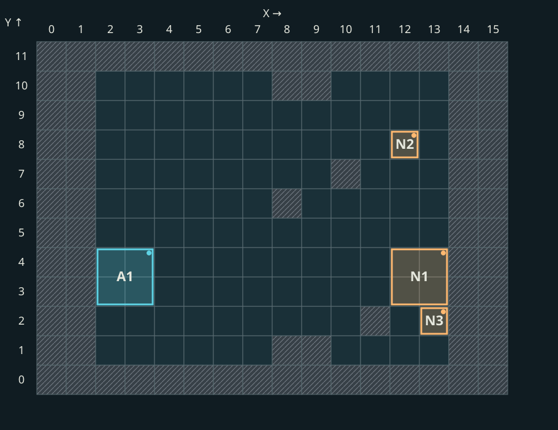](../../assets/placement/pack_8-positions.svg)

Each diagram shows the **whole field**. Cyan `A` stacks belong to the hero; orange `N` stacks are neutrals. The letter and number identify a stack, not its quantity. Hatching marks obstacles and the field boundary.

`X` is the column from left to right; `Y` is the row from bottom to top. These are grid coordinates, not screen positions: rotating the camera does not change them. For example, genie stack `N1` has anchor `(13,4)` near the right edge and occupies a 2×2 square. Open a diagram to inspect its cells.

## Why army strength matters beyond creature counts

The game compares the calculated strength of both armies. Equal creature counts therefore do not guarantee the same formation against different heroes.

| Input | Its role in the calculation |
|---|---|
| Quantity, damage, attack, defence and health | Supply the starting characteristics of stacks and armies |
| Initiative, speed, morale, luck and starting action-bar position | Contribute to the activity estimate |
| Ability resources and rune states | Provide separate activity adjustments; a rune's state matters |
| Damage absorption and protection reserves | Change calculated survivability; starting Orc rage can matter before the first turn |

Morale and luck contribute before combat starts. Skills, artifacts and effects may change the characteristics used. A bonus need not move the neutrals: the comparison may remain on the same side of its threshold.

Activity and survivability adjustments were checked separately, including runes and Blood Rage. The meaning of every rune state has not yet been fully established. [Details and verification limits](../reference/placement-internals.md).

## Before cells are chosen

**The game first decides how many battle stacks the map object's army will produce.** In the inspected path, two or more original stacks are copied into combat with their types and quantities. A separate splitting rule applies when there is **one** original stack. This does not rule out a mod or special combat changing the army earlier.

For one stack, the game evaluates the hero army's strength against the neutrals and chooses an **initial** number of parts. In the investigated ordinary path, both small and large creatures have a limit of four:

| Hero strength relative to neutrals | Initial parts |
|---|---:|
| Less than half | 4 |
| From half up to neutral strength | 3 |
| At least neutral strength | 2 |

The game then makes a random adjustment: one result reduces the number by one; another can increase it by one up to the limit. Finally, there cannot be more parts than creatures or fewer than one. **When there is no split:** one original stack can remain one if an initial count of two is reduced to one; a lone creature also cannot form two stacks. With two or more original stacks, this splitting branch does not run at all. **One map stack therefore need not split the same way in every battle:** relative strength, exact neutral quantity, and the random result can change. The table gives the initial choice, not a guaranteed combat-stack count; code conditions were checked, but random-result frequencies were not. [Technical limits](../reference/placement-internals.md).

Once the part count is chosen, creatures are distributed nearly evenly. **If ten creatures have already been assigned to three parts**, the result is **4 + 3 + 3**. With three or four parts, interior stacks may receive an upgrade of the original creature; the endpoints keep the original type. Splitting, a possible upgrade, and cell selection are three separate decisions.

Without exact scouting information, our Universe build shows neutral quantities as ranges, such as **1–9** or **10–19**. A range limits the possible creature count but does not reveal the exact number. Scouting or an equipped Crown of Many Eyes can reveal the guard's exact original composition; this still does not reveal how the game will split it into combat stacks. Players know their own army, but not every input to this comparison before combat. See the [research diary](../reference/research-diary.md#placement-policy) for the checks.

[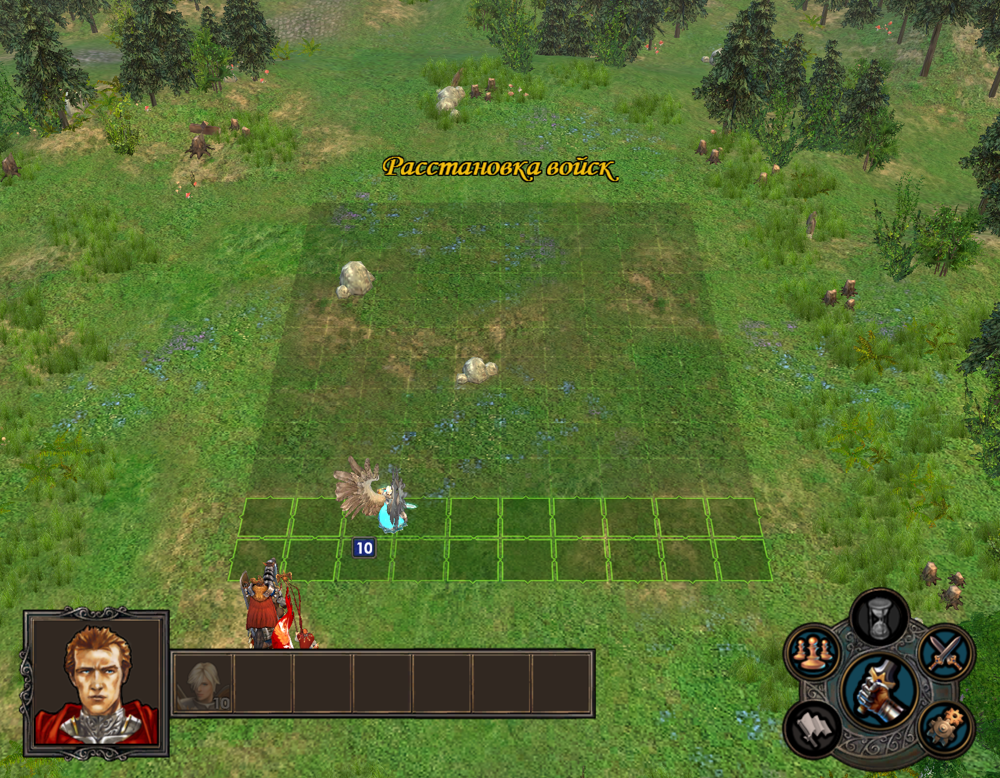](../../assets/placement/academy-before.png)

*Before confirmation, the player sees their creatures and the obstacles. Neutral models are not shown yet.*

[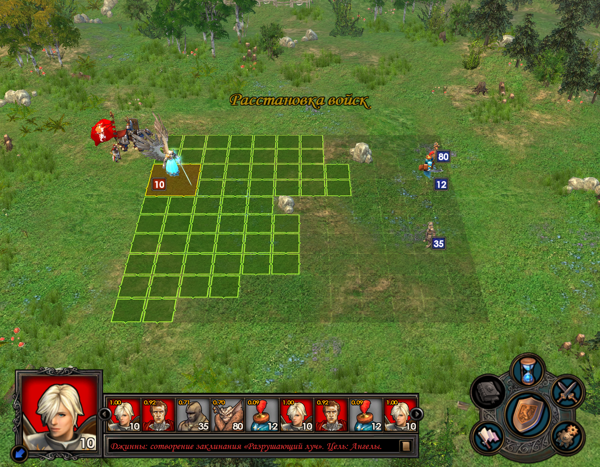](../../assets/placement/academy-after.png)

*After confirmation, the neutral positions become visible in the same battle.*

## When ordinary, sheltered, or spread formation is chosen

**After preparing stacks, the game selects a formation method before choosing cells.** Investigated ordinary combat has a simple path that distributes stacks along the field's height and a more complex path that evaluates both armies. The path choice depends on the auto-placement setting and the map object's original army records; not all special entry conditions have been identified. If some stacks have already been placed, a separate path preserves their cells and fills the remaining positions. The rules below concern the **complex path**.

| Decision | What the game compares | What changes on the field |
|---|---|---|
| Shelter shooters | One branch requires own shooters' strength to be **strictly above 20%** of own army strength and **strictly above 1.3 times the opposing shooters' strength**. A separate capability check can select sheltering without these thresholds; another can veto it. | A defensive pass runs before ordinary placement. Without spread, some stacks seek cells near shooters. |
| Spread stacks | The game compares the opponent's calculated area-attack strength with the total calculated strength of **that same opposing army**. In the tested Universe settings, the ratio must be **strictly above 35%**. Further conditions apply. | Candidate rows are spaced so stacks do not all cluster together. |
| Ordinary formation | Neither extra decision is enabled. | Stacks follow the general category and row order. |

“Own shooters” here means the shooters of **the side currently being deployed**; for neutrals, those are neutral shooters. Merely having a shooter is insufficient: the game compares its strength with the rest of the army and with the opponent. These thresholds come from the tested build, but **are not the entire check**: capabilities of both sides are also considered. Their evaluation order is reconstructed; gameplay names for some rare states remain unidentified. Shelter and spread can occur together; the defensive pass then uses spaced rows instead of simple adjacency. [Complete condition and verification limits](../reference/placement-internals.md).

“Strength” here is the game's internal estimate, not creature count or summed health. When the opponent has no shooters, the game handles that case separately without dividing by zero. Area-attack strength includes eligible creature attacks and spells, including the hero's spells.

Spread is not an eyeballed “every second row” rule. With **10 available rows** and **3 stacks**, the initial spaced set is **1, 5, 10**. The game retains its previous priority among those rows and rejects occupied places; a large creature still needs a free 2×2 square. If spaced positions do not fit, other valid cells are attempted.

This is why a visually similar pack may form differently. In two recorded battles with the same hero and the same visible neutral quantity labels, the game's internal shooter-strength share was about **21.7%** and **18.3%**. The first exceeded the 20% threshold and accompanied sheltering; the second fell below it and accompanied ordinary formation. Exact neutral counts were not retained for those two battles, and the arenas differed, so no single changed input can be declared the sole cause. The record does show **which comparison switched branches**. [Both observations](../reference/research-diary.md#placement-defence-2026-09-26).

## How the chosen formation becomes cells

The following is the general placement path. When sheltering is enabled, the defensive pass runs **before it**; the general pass still attempts to place any remaining stacks.

First the game calculates **deployment depth**: how many columns at that side of the field can hold starting positions. The whole battlefield does not change size. Free space, large creatures, and the Tactics advantage affect the depth; in the tested Universe build, four or more large stacks added a column. This is not a rule established for every Heroes V version.

1. **Check size.** A small creature needs one free cell; a large creature needs a free 2×2 square. One obstacle or occupied cell inside that square rejects the entire position.
2. **Rank rows.** From the deployment edge, the game checks how far each row remains free towards the opposing side before an obstacle. Shooters and other stacks use the row information differently.
3. **Place groups in sequence.** The general pass handles large non-shooters, then shooters, linked goblins and creatures that use them, then creatures with a magic-resistance aura or shield cover, and finally ordinary small non-shooters. Within groups, calculated stack value, speed, flight and the distance between armies matter; one special sort puts non-flyers before flyers. This is **not combat turn order**.
4. **Reserve cells immediately.** Each later stack tries suitable positions again, skips occupied cells, and takes the first available one. If space runs out, the game has further attempts.

If a stack still lacks a cell, the complex path may **shift its chosen row window and retry**, then scan other available deployment columns. This does not mean the game necessarily merges stacks or deletes creatures: in the checked code, an apparent same-type merging branch never enters its inner loop. [Fallback analysis](../reference/placement-internals.md).

[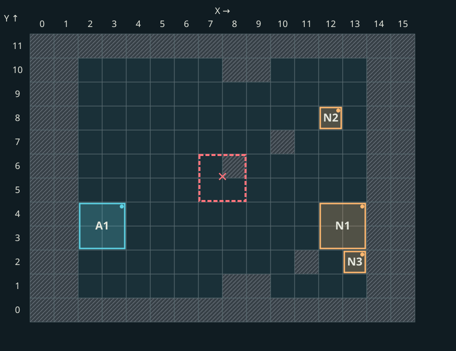](../../assets/placement/pack_8-footprint.svg)

*The red outline is an illustrative 2×2 attempt. A blocked cell inside it rejects the entire square; both armies retain their recorded positions.*

[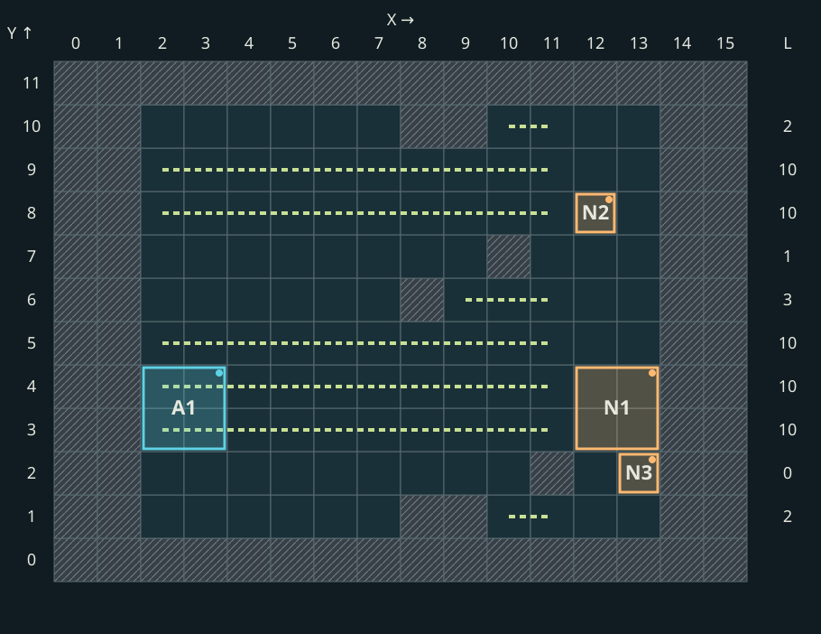](../../assets/placement/pack_8-approach.svg)

*Lines show where an obstacle stops a row scan. This measures available space before deployment; it is not a creature's movement route in combat.*

When rows score equally, the game does not simply proceed top to bottom. For ten equal rows in the checked field, candidate-row order was **8, 4, 6, 10, 2, 7, 3, 5, 9, 1**. This is a list of *candidate rows*, not ten creatures' final cells: occupancy and footprint still change the outcome. [Tie rule and exceptions](../reference/placement-internals.md).

### How shooter rows are selected

The game seeks a **group of consecutive rows for shooters**. Its length equals the number of shooter stacks, capped at the number of playable rows. It adds the free approach lengths for each possible group and selects the first group with the lowest sum. A group may span the end and beginning of the row list. These are not final cells: candidate order, occupancy and creature size still apply.

An additional condition depends on the opposing army: the game compares the strength of its **large non-shooters** with that of **all its non-shooters**. When the share strictly exceeds the threshold — about **55%** in the checked build — the approach is evaluated across two adjacent rows, stopping at the first obstacle in either. The first playable row keeps its single-row score: its neighbour does not wrap around from the other edge of the field.

Both strength estimates include the hero contribution, even when no creatures qualify. A hero with only shooters can therefore have two equal, positive estimates: the share is **100%**, despite having no large creatures. This explains why changing the hero's army can move neutral shooters without changing their composition. [Exact rule and verification limits](../reference/placement-internals.md#shooter-window).

## Worked battle: four elementals

Here **four stacks of 15 elementals** face the hero's angels. We recorded both final cells and the game's placement attempts. In the diagram, `A1` marks angels; `N1` Earth, `N2` Air, `N3` Water, and `N4` Fire.

[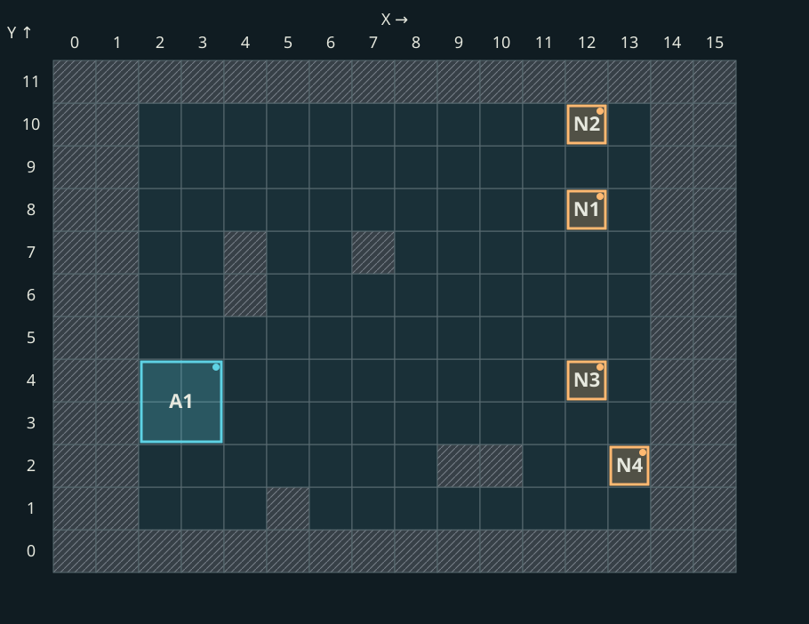](../../assets/placement/elementals_trace-positions.svg)

The game chose neither sheltering nor spread formation in this battle. The 16×12 grid includes a service boundary; playable cells here have `X=2…13` and `Y=1…10`. In the recorded pass, the shooter starts in column `X=13` and small non-shooters in `X=12`.

### Why Fire stands low

Fire is the only shooter. The game measured free approach in each row. An obstacle leaves only one approach cell in **Y=2**, making this the shooter's first row.

[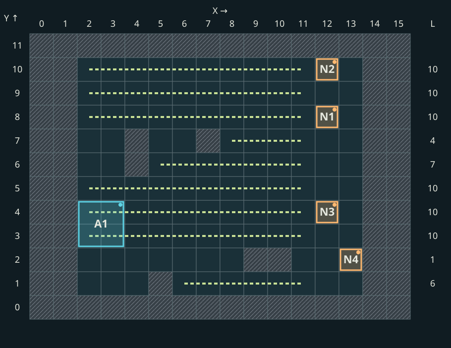](../../assets/placement/elementals_trace-approach.svg)

Cell `(13,2)` was free, so Fire succeeded on the first attempt.

[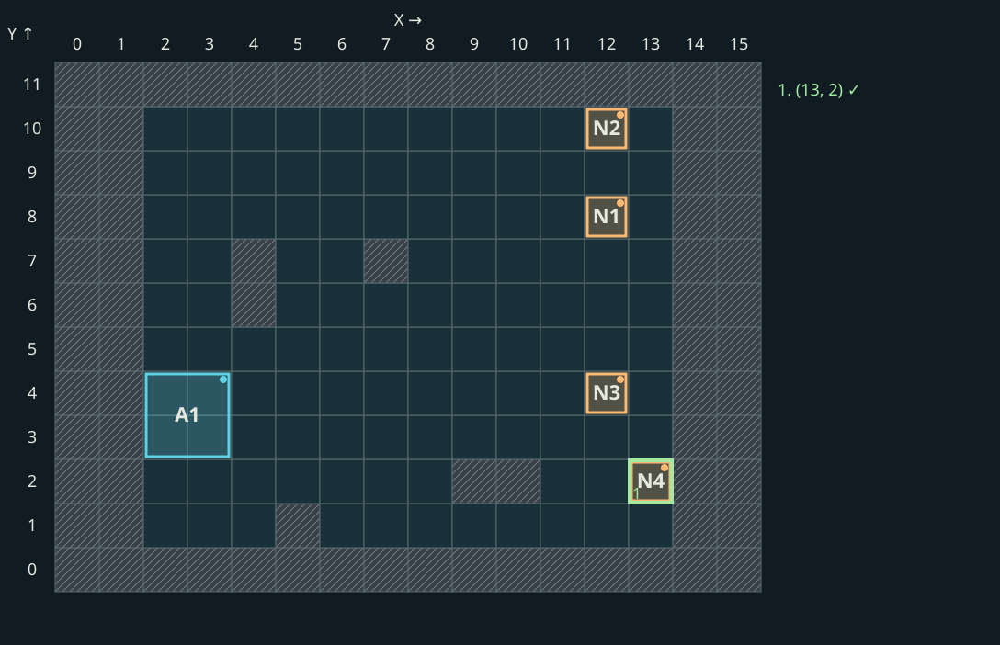](../../assets/placement/elementals_trace-fire.svg)

### Why the others do not simply line up

Among the three remaining stacks, Earth and Water cannot fly, while Air can. In the checked comparison, Earth precedes Water by stack-strength score; Air follows them. Their first suitable rows are **8, 4, 10**. This comes from the row scan and the game's tie order, not from counting down the picture.

[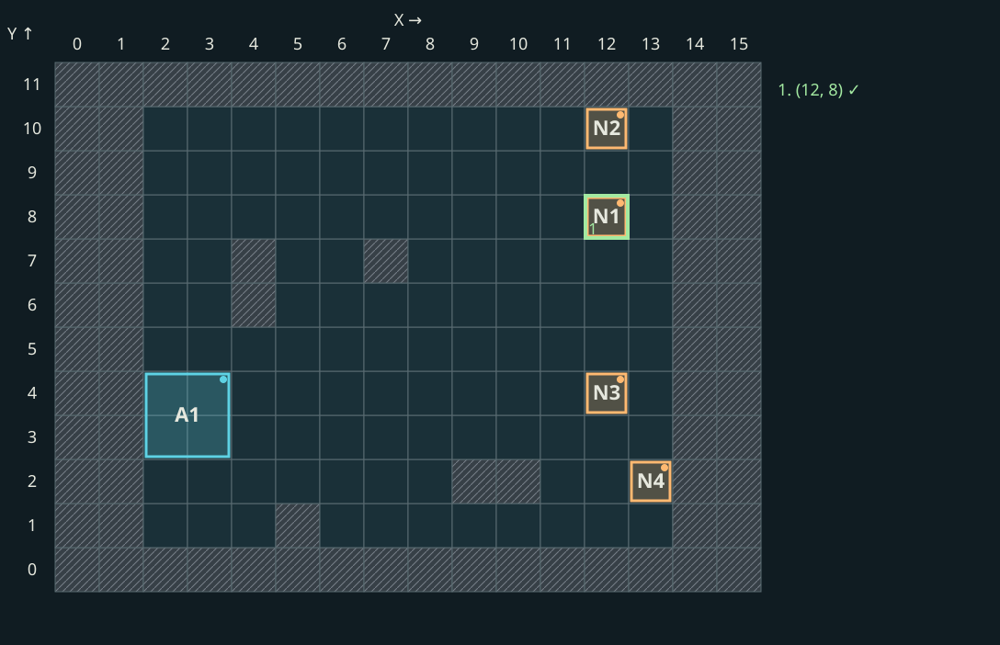](../../assets/placement/elementals_trace-earth.svg)

Earth first tries `(12,8)` and occupies it. Water **starts at the beginning of the same list**: `(12,8)` is now occupied, so it moves to `(12,4)`.

[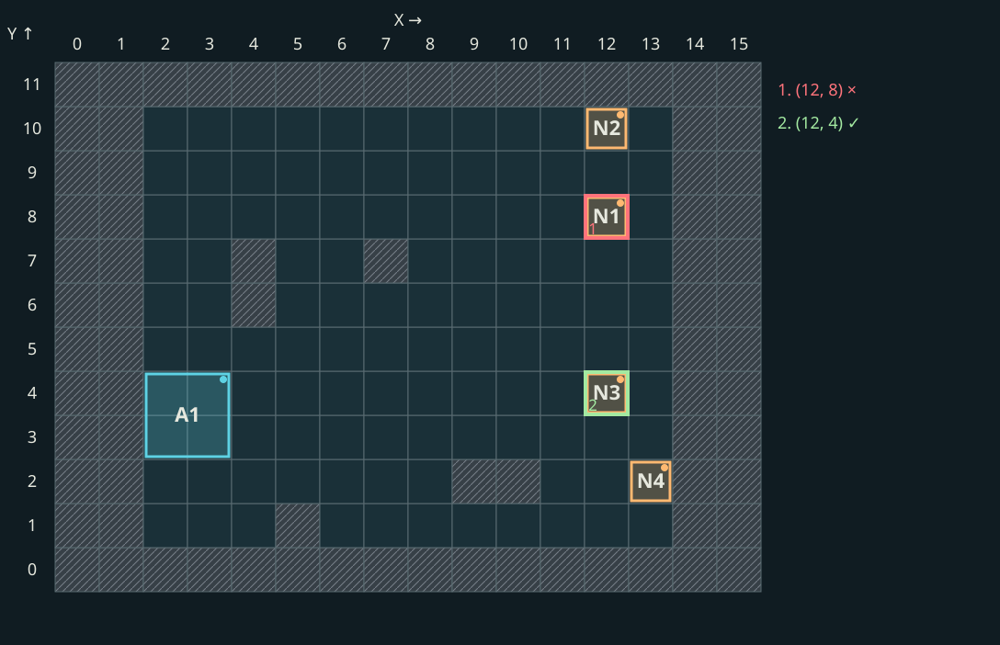](../../assets/placement/elementals_trace-water.svg)

Air also starts at the beginning: Earth occupies `(12,8)`, Water occupies `(12,4)`, and the third attempt `(12,10)` succeeds.

[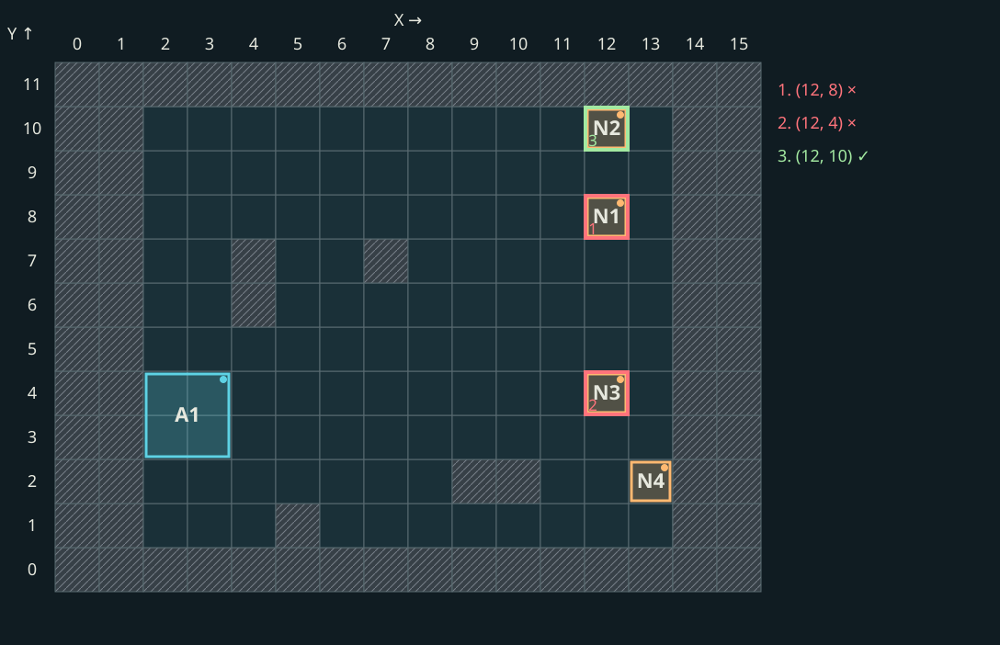](../../assets/placement/elementals_trace-air.svg)

| Stack | Game attempts | Final cell |
|---|---|---|
| Fire | `(13,2)` free | `(13,2)` |
| Earth | `(12,8)` free | `(12,8)` |
| Water | `(12,8)` occupied; `(12,4)` free | `(12,4)` |
| Air | `(12,8)` and `(12,4)` occupied; `(12,10)` free | `(12,10)` |

**All seven attempts and four final cells match the game's record.** This explains *this* battle, not every sheltered or spread formation. The [field and attempt data](../../assets/placement/observations.json) are available separately.

## A different arena

Another field contained the same four creature types. Row `Y=2` offered more free space, while an obstacle shortened the approach in `Y=3`. If we apply the same ordinary pass, Fire moves from `(13,2)` to `(13,3)`; Earth, Water, and Air remain in rows 8, 4, and 10.

[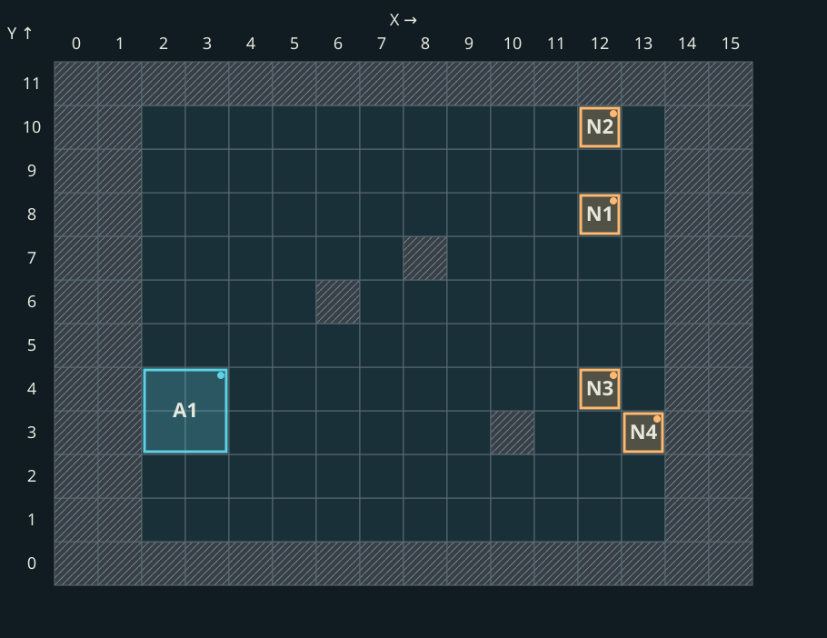](../../assets/placement/pack_12-positions.svg)

[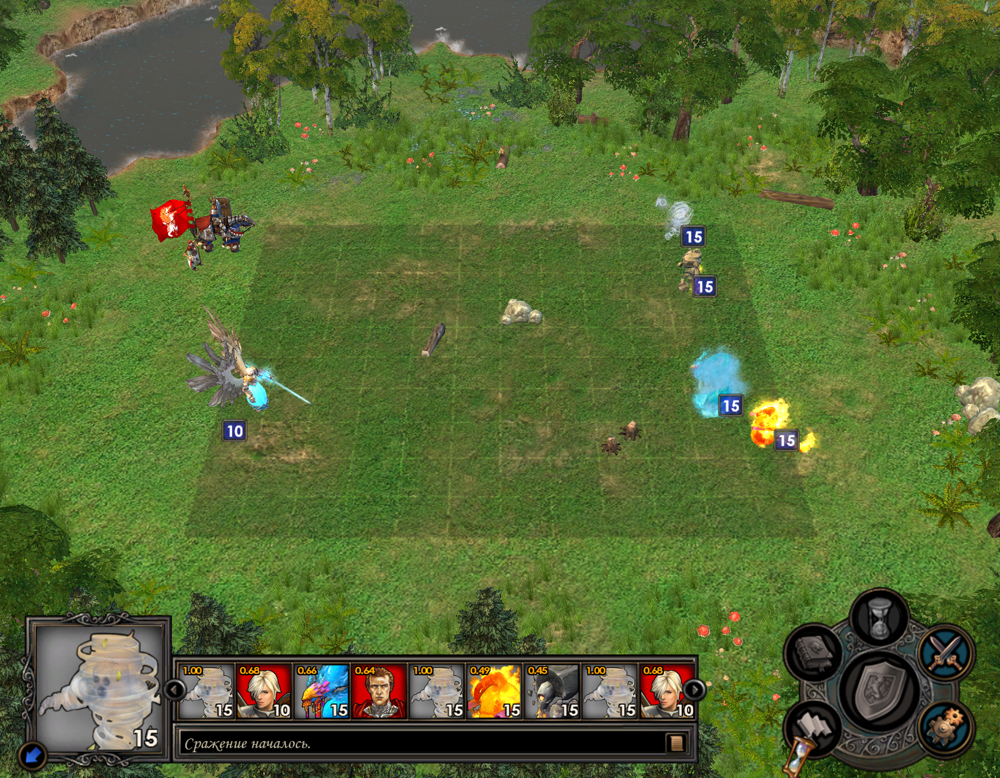](../../assets/placement/pack_12.png)

All four calculated cells match that battle's Start record. But its internal formation mode was not captured: a matching result **does not prove** the game used this particular pass.

## A large stack needs a whole square

In a different mixed battle, a large demon occupies `(12,3)`, `(13,3)`, `(12,4)`, and `(13,4)`. Checking only one “main” cell is insufficient: the whole square must be free.

[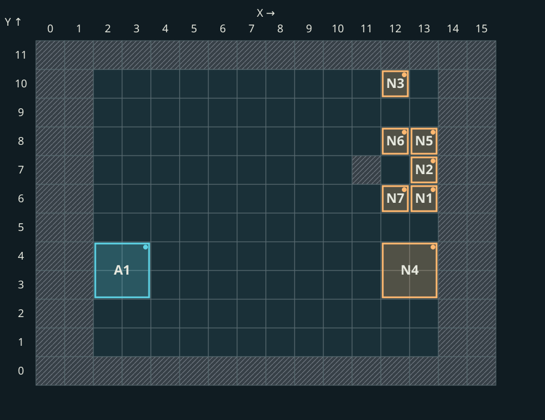](../../assets/placement/pack_15-positions.svg)

[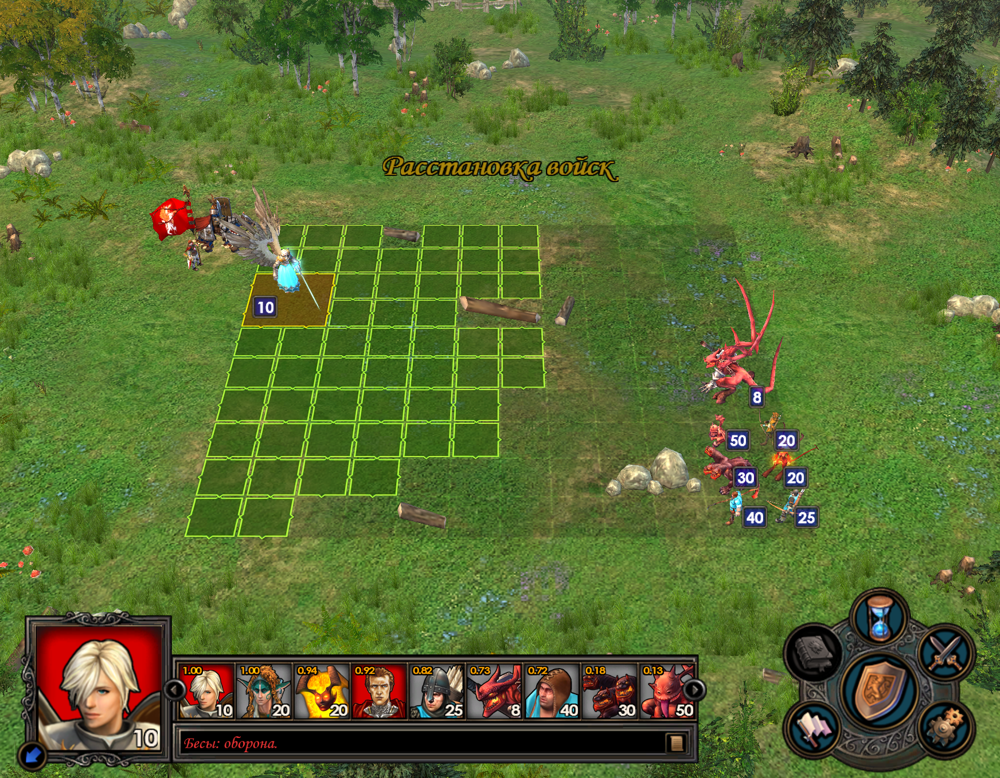](../../assets/placement/pack_15.png)

The screenshot shows the stack's size but does not explain **all seven** neutral positions. That requires a game attempt record like the elemental example.

## What we found in mixed armies {#mixed-armies}

**Sheltering changes more than row rankings: it changes the candidate cells.** The defensive pass visits free neighbors of occupied cells and removes duplicates. Cells in the chosen shooter rows rank highest, neighboring rows next, and other rows lowest. Ties follow the game's traversal order, not a random pick.

A large defender must fit its entire 2×2 square at each attempt. Giving every defender “the next row” therefore fails: placing one stack changes the next stack's options. When sheltering and spread are both enabled, spaced rows are used. [Pass analysis and verified limits](../reference/placement-internals.md).

## What can be predicted beforehand

The field, obstacles, creature sizes and the player's own army help identify possible positions. When the game shows only a range such as **“1–9”** or **“10–19”**, the exact count is still unavailable. In tested ordinary guards, Scouting or an equipped Crown of Many Eyes reveals the original composition. That army may still pass through the combat-stack splitting rule.

The final stacks and all formation decisions are therefore not always known before combat. Even identical visible ranges do not guarantee the same sheltered formation. This is **expected uncertainty**; other discrepancies need separate investigation.

The findings cover investigated ordinary Universe battles. Sieges, special combats, and other builds have not been established as equivalent. Exact technical rules, code for the worked pass, and exceptions are in the [reference](../reference/placement-internals.md). The [research diary](../reference/research-diary.md#elementals) records the experiment; the [test map](../modding/test-maps.md) is available separately.

## Evidence and limits {#evidence}

On October 12, 2026, the reconstructed algorithm passed a separate new series: **273/273 full matches** across ten fresh loads of the polygon and two random maps. Every stack's composition, quantity, footprint and cell was saved before Start, then compared with the actual initial army; unchanged calculations, terrain and battle identity were checked separately. This validates the declared series, not every level, effect or arena. [New verification conditions](../reference/research-diary.md#placement-native-release-2026-10-12).

After reconstructing the rules, a separate research series gave **273/273 full matches: 762 stacks across ten map loads**. Calculated composition, quantities and cells were frozen before Start, then compared with the actual initial army. The series used the polygon and two random maps, varied armies and level-one heroes. Other levels, effects and arenas need separate checks. [Series conditions and results](../reference/research-diary.md#placement-player-candidate).

The illustrations and worked example come from battles recorded on **September 23, 2026**, on `WorkshopPolygon`. Both armies' cells were recorded at combat Start, before the first turn; obstacles were recorded beforehand. For the main example, the game mode and seven placement attempts were also captured. Final cells were not supplied as calculation inputs. This is our research, not an official Nival specification.

[Investigated build and EXE SHA-256](../reference/universe-build.md) · [Published diagram data](../../assets/placement/observations.json) · [Method and technical limits](../reference/placement-internals.md). The public map copy does not lock the hero, random state, or arena of each archived run, so a repeat playthrough may produce different cells.
