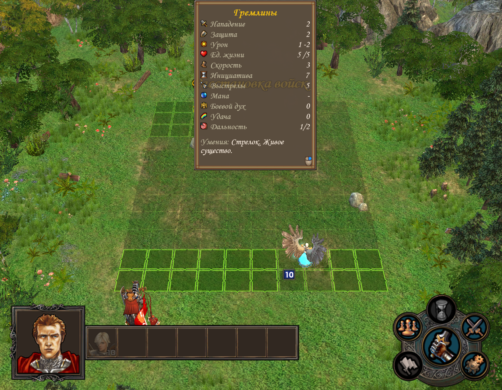
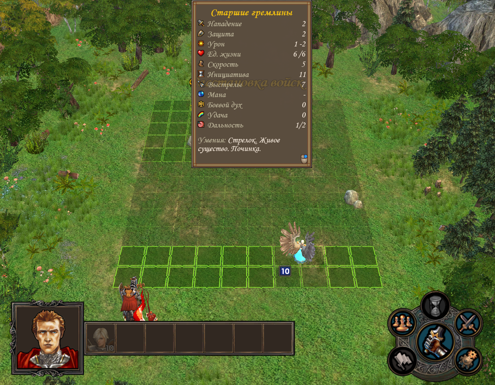

# Предиктор расстановки

Проекция отмечает **предполагаемое место существа и доступную ему область хода** до Start. После начала боя кнопка **«Расстановка»** над шкалой хода открывает прогноз и фактические позиции рядом. Это альфа-версия для [проверенной сборки Universe](../reference/universe-build.md), а не поддержка всех версий игры.

## Состояние разработки

Пакет **0.2.0-alpha.3** исправляет проверку защиты стрелков в приблизительном прогнозе. В завершающей серии он угадал все занятые клетки в **191 из 213 смешанных боёв — 89,7%**. Смешанными здесь считаются охраны с несколькими публичными исходными отрядами; разделившиеся одиночные охраны считаются отдельно. Показатель описывает геометрию занятых клеток; тип существа на каждой позиции проверяется отдельно. Предыдущая alpha.2 дала 165/213 — 77,5%; количества и арены свежих загрузок различаются, поэтому проценты не показывают эффект исправления на одинаковых входах.

Есть два независимых расчёта. **Приблизительный прогноз виден игроку** и использует публичные типы, числовые диапазоны и известную армию своего героя. В проверенных обычных охранах «Разведка» или надетая «Корона всевидящего» допускают точный исходный состав. Готовое разделение нейтралов и скрытые грейды не являются его входами. Подхват результата «Быстрой битвы» остаётся в плане.

**Полный расчёт скрыт до Start** и не заполняет приблизительный прогноз. Он нужен для проверки алгоритма и пояснений после начала боя. В той же серии он точно повторил существ, количества, размеры отрядов и клетки в **273 из 273 боёв**. Самостоятельный запуск пакета проверен без SDK. Другие уровни, эффекты и арены требуют отдельных проверок. [Условия и ограничения серии](../reference/research-diary.md#placement-defensive-normalization-2026-10-13).

В окне «Расстановка» два одинаковых по размеру поля: слева прогноз, справа факт. Синий обозначает прогноз, оранжевый — факт, зелёный — армию героя. Препятствия показаны на обоих полях; крупные существа занимают весь квадрат 2×2. Цифры обозначают номера отрядов, нумерация рядов находится со стороны нейтралов.

Выбери отряд, чтобы увидеть положение и правило размещения. Пояснения формируются кодом мода без AI и внешнего сервиса. Если полный расчёт не подтвердился для всего пака, причина отмечается как неподтверждённая. Если прогноза не было, показывается только факт.

Максимальное расширение армий, уровней, навыков, артефактов и арен записано в дальнейший план. Исторические результаты прежних DLL сохранены в дневнике и не переносятся на новую версию.

## Скачать и установить

**[Скачать пакет 0.2.0-alpha.3](https://github.com/Xaaalera/heroes5-deployment-preview/releases/download/v0.2.0-alpha.3/Heroes5DeploymentPreview-0.2.0-alpha.3.zip)**. В нём отдельная DLL предиктора, игровой файл интерфейса H5U и общие DLL загрузчика. Code → Download ZIP скачивает исходники, а не готовый мод.

[Страница мода на GitHub](https://github.com/Xaaalera/heroes5-deployment-preview) · [Universe](https://h5lobby.com/).

Для готового ZIP-пакета нужны Windows и поддерживаемая игра. Python, Git и компилятор не нужны.

1. Закрой игру.
2. Распакуй ZIP в отдельную папку. Сохрани существующие `bin/dinput8.dll`, `bin/d3d9.dll` и `bin/d3d9.universe.dll`, если они есть, в резервную папку.
3. При первой установке наших новых DLL-модов переименуй исходный `bin/d3d9.dll` игры в `bin/d3d9.universe.dll`. Если оригинал уже сохранён под этим именем, не заменяй его. Если происхождение файла неизвестно, сначала восстанови оригинал из своей проверенной установки Universe.
4. Скопируй **обе папки `bin` и `UserMODs`** из архива в папку игры. Должны появиться `bin/Heroes5Mods/Plugins/deployment-preview.dll` и `UserMODs/workshop-deployment-preview-ui.h5u`; общие `dinput8.dll` и `d3d9.dll` находятся рядом с `H5_Game.exe`. Для нескольких наших модов используй одну версию общих DLL. Совместимость с посторонними загрузчиками проверяется отдельно.
5. При обновлении с preview.2 убери его старую DLL `bin/Heroes5Mods/WorkshopDeploymentPreview.dll`, чтобы не загрузить две версии предиктора.
6. Запускай игру как раньше через Heroes/Lobby. Отдельного EXE нашего мода нет; SDK игроку не нужен.
7. Начни обычный бой: до Start должны появиться проекции. Наведение показывает область хода, ПКМ — карточку существа. После Start открой «Расстановка» над шкалой хода.

При ошибке совместимости сверь [поддерживаемую сборку](../reference/universe-build.md) и верни резервные копии. Сохранённый оригинал `d3d9.universe.dll`, а также `uni.dll` и `um.dll` не заменяй файлами из случайного архива.

## Отключение и удаление

Закрой игру и убери `bin/Heroes5Mods/Plugins/deployment-preview.dll` и `UserMODs/workshop-deployment-preview-ui.h5u`. Общие `dinput8.dll` и `d3d9.dll` оставь, если их используют другие наши моды. После удаления всех таких модов можно убрать нашу `d3d9.dll`, вернуть исходному `d3d9.universe.dll` имя `d3d9.dll` и восстановить резервную копию `dinput8.dll`. Если до установки `dinput8.dll` в папке игры не было, вместо восстановления удали наш файл после удаления всех наших DLL-модов. Не удаляй сохранённый оригинал Universe вместе с одним плагином.

[Разработчикам: сборка и тестовый стенд](../modding/devkit.md#mod-sources).

## Совместимость

Мод разработан для [исследованной сборки Universe](../reference/universe-build.md). Текущий пакет прошёл самостоятельный запуск и объявленную серию из 273 боёв. Другие сборки, посторонние загрузчики и все возможные сочетания модов не подтверждены.

## Управление

| Действие | Результат |
|---|---|
| Наведение | Область хода выбранного справочного типа |
| Первый ПКМ | Полная карточка базового или уже известного грейда |
| Повторный ПКМ, если грейд неизвестен | База → улучшение → альтернативное улучшение → база |
| Двойной ЛКМ | Подробное штатное окно существа |
| Стрелки подробного окна | Переключение доступных вариантов |
| Start | Удаление проекций, карточек и подсветки |
| «Расстановка» после Start | Прогноз, начальные позиции и пояснения |

Если грейд известен, карточка показывает его. Фигуры непрозрачные, со слабым тёплым свечением. Дополнительных нижних стрелок в текущем варианте нет.

## Пример: гремлин и его улучшение

При переключении скорость меняется с **3 на 5**, здоровье — с **5 на 6**. Вместе с карточкой пересчитывается область хода.

Характеристики не зашиты под показанных существ. `Speed`, `Flying` и `CombatSize` читаются из [определения выбранного типа](../reference/creatures.md); название и поля карточки формирует штатный descriptor. Тип входит в ключ кэша, поэтому область хода другого грейда не должна оставаться прежней.

## Почему в подробном окне количество «1»

Для справки создаётся одно существо без героя и реального боевого стека. Эта единица **не означает одного противника в охране**. Карточка также не учитывает подтверждённые только в реальном бою эффекты.

## Когда прогноз расходится с боем

Приблизительный прогноз может ошибиться из-за неизвестного точного количества, грейда, разделения или выбранной ветки построения. В серии этой версии осталось **50 расхождений числа отрядов и 22 расхождения занятых клеток при одинаковом числе отрядов**. Ещё в 18 боях занятые клетки совпали, но типы существ на них различались: 11 раз при одинаковом наборе типов (с учётом повторений), 7 раз с отличающимися типами. Причина этих семи отличий типов пока не подтверждена. Неизвестные входы не объясняют автоматически каждый промах. [Результаты и ограничения](../reference/research-diary.md#placement-defensive-normalization-2026-10-13).

До Start прогноз строит один отряд на публичную исходную запись. Игра может разделить единственный исходный отряд; готовое разделение в приблизительный расчёт не подставляется.

В проверенном примере одна проекция крестьянина перед Start превратилась в **три боевых отряда по 10**. Причина расхождения — разделение, а не размер клетки. [Как сама игра строит армию](army-placement.md).

Открытие карточек, переключение грейдов, подробное окно и его стрелки имеют отдельные проверки. Удержание ПКМ и все возможные существа не объявляются проверенными. В окне после Start можно сравнить прогноз с фактом и прочитать подтверждённое правило фактической расстановки. Это объяснение не исправляет задним числом показанный до Start прогноз.

[Запись исследования](../reference/research-diary.md#projection-range).
